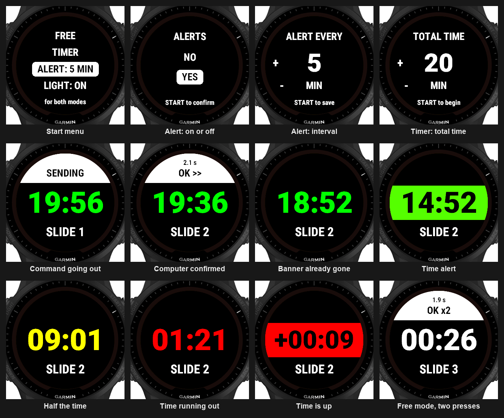
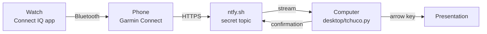
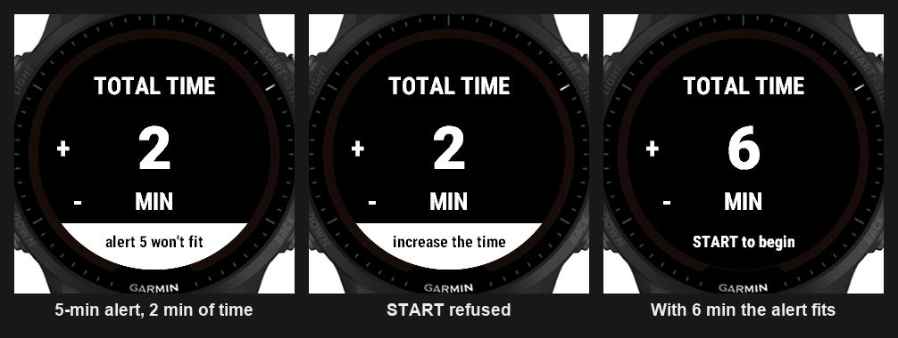

<p align="center">
  
</p>

<h1 align="center">Tchuco Tchuco</h1>

<p align="center">
  Change slides from your watch.<br>
  A Garmin Forerunner 955 becomes your presentation remote,
  with a timer and time alerts on your wrist.
</p>



You press START on the watch and the slide advances on the computer. The watch
does not talk to the computer directly: the command leaves through the phone,
goes through an [ntfy.sh](https://ntfy.sh) topic and reaches a Python script
that presses the arrow key. That is why the two can be on different networks,
and there is no server of your own, no phone app, no database and no login.

- **Buttons only.** START goes forward and DOWN goes back. The touchscreen is
  ignored, so an accidental brush never changes a slide.
- **Confirmation on your wrist.** "OK" and the vibration only come after the
  computer has run the command.
- **Two modes.** Free, with a stopwatch that counts up, or timer, with a
  countdown that goes from green to red and five strong vibrations at the end.
- **Optional time alerts.** Three soft vibrations at every interval you
  choose.
- **Any slide program.** The script only presses the arrow keys, in whatever
  window is in the foreground.

## Contents

- [How it works](#how-it-works)
- [What you need](#what-you-need)
- [Setup](#setup)
- [Using the app](#using-the-app)
- [Notifications during a presentation](#notifications-during-a-presentation)
- [Troubleshooting](#troubleshooting)
- [Test plan](#test-plan)
- [Under the hood](#under-the-hood)
- [Known limitations](#known-limitations)
- [Project status](#project-status)
- [Contributing](#contributing)
- [License](#license)

## How it works



1. The watch app sends `next` or `prev` through the paired phone (Garmin
   Connect, over Bluetooth).
2. The phone publishes the command, over HTTPS, to a topic on ntfy.sh, a
   public messaging service. The topic name is the secret that ties the two
   sides together.
3. The computer script listens to that topic, presses the right or the left
   arrow and publishes a confirmation to `<topic>-ack`.
4. The watch polls for the confirmation and only then shows "OK".

| Folder | What it is |
|---|---|
| `watch/` | The watch app (Connect IQ, Monkey C, target `fr955`) |
| `desktop/` | The computer script (Python 3, a single file) |
| `docs/` | Images for this README |

## What you need

- **Watch:** Garmin Forerunner 955 or 955 Solar.
- **Phone** paired with the watch, with the Garmin Connect app and internet
  access.
- **Computer** running Windows or macOS, with Python 3 and internet access.
  This is the one showing the slides.
- **To build the app:** Java 11 or newer, the Connect IQ SDK (free, it asks
  for a Garmin account), `openssl` and a USB cable.

You do not need an ntfy.sh account.

The app was written for the 955. Other Connect IQ watches would need their
product added to `watch/manifest.xml` and the screen and buttons checked; that
has not been tested.

## Setup

There are ten steps: the first three take care of the computer, and steps 4 to
9 take care of the watch. Every command runs from the project folder.

### 1. Get the project

Clone this repository, or download the ZIP from GitHub's **Code** button, and
open a terminal in the project folder:

```
git clone https://github.com/santos-wesley/tchuco-tchuco.git
cd tchuco-tchuco
```

### 2. Create your topic

The topic works as a password: whoever knows its name can change your slides.
Use a long random name and keep it out of git. To generate one:

```
python -c "import secrets; print('tchuco-' + secrets.token_hex(16))"
```

Keep the result. The same topic goes on the computer (step 3) and on the watch
(step 6).

### 3. Set up the computer

Requirements: Python 3 (tested with 3.13) and the `pynput` package.

```
python -m venv .venv
.venv\Scripts\activate          (macOS: source .venv/bin/activate)
pip install pynput
```

Give the script your topic and run it in rehearsal mode, which only prints the
commands and presses no keys:

```
# Windows (PowerShell)
$env:TCHUCO_TOPIC = "your-topic"
python desktop\tchuco.py --dry-run

# macOS
export TCHUCO_TOPIC="your-topic"
python desktop/tchuco.py --dry-run
```

In another terminal, with the same variable set, publish a test command (in
PowerShell use `curl.exe`, because `curl` is an alias for another command):

```
curl.exe -d "next" "https://ntfy.sh/$env:TCHUCO_TOPIC"      (PowerShell)
curl -d "next" "https://ntfy.sh/$TCHUCO_TOPIC"              (macOS)
```

The script should print something like this:

```
12:00:00 topic tchu... on https://ntfy.sh (dry-run: no keys are pressed)
12:00:00 connected; waiting for commands (Ctrl+C quits)
12:00:07 next -> right arrow
```

For the real thing, run it without `--dry-run` and keep the presentation in
the foreground, in slideshow mode. `Ctrl+C` quits.

`python desktop/tchuco.py your-topic` also works, but then the topic is
visible in the terminal; prefer the environment variable if the screen is
being projected.

**macOS:** on the first run, allow the terminal under *System Settings →
Privacy & Security → Accessibility*; without it the system silently drops the
key presses. If you get `CERTIFICATE_VERIFY_FAILED` (Python installed from
python.org), run the `Install Certificates.command` found in the Python folder
under *Applications* once.

### 4. Install the Connect IQ SDK

1. Install Java 11 or newer.
2. From <https://developer.garmin.com/connect-iq/sdk/>, download the **SDK
   Manager**, extract it to a folder and open it.
3. Accept the agreement and sign in with your Garmin account.
4. On the **SDK** tab, download the latest version and set it as the active
   SDK.
5. On the **Devices** tab, download only **Forerunner® 955 / Solar**. All the
   devices together, with their fonts, take about 1.5 GB.
6. (Optional) In VS Code, install the **Monkey C** extension and run
   *Monkey C: Verify Installation*.

### 5. Generate the developer key

The compiler signs the app with a 4096-bit RSA key. It is yours and never
goes into git.

```
openssl genrsa -out watch/developer_key.pem 4096
openssl pkcs8 -topk8 -inform PEM -outform DER -in watch/developer_key.pem -out watch/developer_key.der -nocrypt
```

On Windows, `openssl` ships with Git
(`C:\Program Files\Git\usr\bin\openssl.exe`). Another option is the VS Code
command *Monkey C: Generate a Developer Key*.

### 6. Give the app your topic

Copy the example file and replace the value of `TOPIC` with the topic from
step 2:

```
# Windows (PowerShell)
Copy-Item watch\Config.mc.example watch\source\Config.mc

# macOS
cp watch/Config.mc.example watch/source/Config.mc
```

`watch/source/Config.mc` is ignored by git and is the only file with the base
URL and the topic. Do not create another copy with the `.mc` extension inside
`watch/`: the compiler picks up every `.mc` in the folder.

### 7. Build

```
# Windows (PowerShell)
$sdk = (Get-Content "$env:APPDATA\Garmin\ConnectIQ\current-sdk.cfg").Trim()
& "$sdk\bin\monkeyc.bat" -d fr955 -f watch\monkey.jungle -o watch\bin\TchucoTchuco.prg -y watch\developer_key.der -w -r

# macOS
SDK="$(cat "$HOME/Library/Application Support/Garmin/ConnectIQ/current-sdk.cfg")"
"$SDK/bin/monkeyc" -d fr955 -f watch/monkey.jungle -o watch/bin/TchucoTchuco.prg -y watch/developer_key.der -w -r
```

- `fr955` covers the Forerunner 955 and the 955 Solar.
- `-w` shows the compiler warnings; strict type checking is already turned on
  in `watch/monkey.jungle`.
- `-r` builds the lean release version, which is the one that goes on the
  watch. Without `-r` you get the debug version, which also runs in the
  simulator.

With SDK 9.3.0 the expected result is `BUILD SUCCESSFUL`, with no warnings.

### 8. Try it in the simulator (optional)

```
# Windows (PowerShell)
& "$sdk\bin\connectiq.bat"
& "$sdk\bin\monkeydo.bat" watch\bin\TchucoTchuco.prg fr955

# macOS
"$SDK/bin/connectiq"
"$SDK/bin/monkeydo" watch/bin/TchucoTchuco.prg fr955
```

The first command opens the simulator; the second loads the app and keeps
showing what it prints (for example `sent next: 200` and
`confirmed in 2063 ms`). Click the buttons of the watch drawn on screen with
the mouse. The simulator makes real HTTPS requests from the computer, so the
whole path is exercised, except for Bluetooth and the phone.

Useful in the simulator:

- *Settings → Connection Type → BLE → Not Connected*: simulates a
  disconnected phone (the app shows "NO PHONE", code -104).
- *File → View HTTP Traffic*: shows the requests made by the app.

### 9. Copy it to the watch

1. Connect the watch over USB.
2. Copy `watch/bin/TchucoTchuco.prg` to the watch's `GARMIN/APPS` folder,
   over the previous version, if there is one. The 955 shows up as a media
   device (MTP): on Windows it appears in File Explorer; on macOS you need an
   MTP program, such as OpenMTP, and Garmin Express must be closed.
3. Unplug the cable. The app shows up in the list of activities and apps.

To see the app's `System.println` output on the watch, first create an empty
file with the same name as the `.prg` in the logs folder:
`GARMIN/APPS/LOGS/TchucoTchuco.TXT`.

### 10. Present

1. On the computer, run the script (without `--dry-run`) and put the
   presentation in the foreground, in slideshow mode.
2. Keep the phone nearby, with Bluetooth and internet on and Garmin Connect
   open.
3. On the watch, open Tchuco Tchuco, choose FREE and press START: the slide
   advances, and the watch vibrates and shows "OK >>".

If something does not respond, see [Troubleshooting](#troubleshooting).

## Using the app

The app is operated with the buttons only. Taps and swipes are ignored, and
the app never opens system screens (which would accept touch).

### Start menu

When it opens, the app shows four options; the bottom line of the screen
explains the highlighted one. UP and DOWN choose, START confirms and BACK
closes the app.

| Option | What it does |
|---|---|
| FREE | goes straight to the slide clicker, with no time limit |
| TIMER | asks for the total time and opens the presentation with the countdown already running |
| ALERT: OFF / N MIN | turns the time alerts on or off and sets the interval; applies to both modes |
| LIGHT: ON / AUTO | START toggles between keeping the backlight always on and letting the watch decide |

The menu opens on the last mode used, and every choice is stored on the
watch.

### Settings

- **Total time** (when you choose TIMER): UP increases and DOWN decreases (the
  "+" and "-" on screen sit next to those buttons); START begins the
  presentation.
- **Alerts** (when you choose ALERT): first the NO or YES question; with YES,
  **alert every** comes next, adjusted the same way, and START saves it.

Minutes go by 1 up to 30, by 5 up to 60 and by 15 up to 180. BACK goes back
one screen without saving.

In timer mode the alert has to fit in the time: the interval must be shorter
than the total time. When it does not fit (2 minutes of time with an alert
every 5, for example), the total time screen immediately shows the white band
"alert 5 won't fit" and START stays blocked: the watch vibrates and the band
changes to "increase the time". To move on, increase the total time until the
alert fits, or go back with BACK and change the alert or turn it off. The
menu shows the same "alert 5 won't fit" when TIMER is highlighted. Free mode
has no such limit.



### Presentation

| Button | Action |
|---|---|
| START (top right) | next slide (`next`) |
| DOWN (bottom left, the music one) | previous slide (`prev`) |
| BACK (bottom right) | shows "BACK AGAIN"; a second BACK within 3 s returns to the menu |
| UP (middle left) | nothing |

The screen shows the time, large, and the slide counter.

- **Free mode:** a white stopwatch that counts up from the first slide
  change.
- **Timer:** a countdown that starts as soon as the presentation opens, with
  no need to change a slide. The number goes from green to red in seven
  shades as the time runs out. When the time is up there are five strong
  vibrations, and the number starts showing in red how far over the limit you
  are ("+00:12").
- **Time alerts** (optional, in both modes): the middle of the screen lights
  up for 3 seconds and the watch gives three soft vibrations. In free mode
  that happens at every chosen interval; in timer mode, when multiples of the
  interval remain (15, 10, 5 minutes left, for example).

The result of each command shows up in a white banner with black text at the
top (always the same color, so it is not mistaken for the time colors) and
goes away by itself: 3 seconds after an "OK" and 10 seconds after a failure.

| Banner | Meaning |
|---|---|
| "SENDING" | the command is on its way to ntfy |
| "CONFIRMING" | ntfy got it; waiting for the computer to answer |
| "OK >>" / "<< OK" | the computer ran it; above, how long it took |
| "OK x2" | two (or more) quick presses were run |
| "NO PC" | ntfy got it, but no computer answered |
| "NO PHONE" / "NO INTERNET" / "HTTP ERROR" | the command did not go out; above, the error code |

| Vibration | When |
|---|---|
| one soft, short one (50 ms) per command | the computer confirmed; two quick presses give two |
| one soft, longer one (300 ms) | the send failed, the computer did not answer or START was blocked |
| three soft ones, one per second | time alert |
| five strong ones (500 ms), one per second | the time is up |

## Notifications during a presentation

The app cannot hide the watch's notifications. The Connect IQ API has no way
to block them or to turn on Do Not Disturb; it only lets an app read whether
it is on. If a message arrives in the middle of the presentation, the watch
shows its own alert on top of the app, and while that alert is on screen the
buttons may act on it instead of changing the slide.

The way out is to silence notifications on the watch itself before you start:

- **Do Not Disturb.** Hold LIGHT to open the controls menu and turn on Do Not
  Disturb. According to the [955 manual][manual-controls], this mode dims the
  screen and disables alerts and notifications. Check on your watch that
  Tchuco Tchuco's vibrations and the backlight still behave the way you
  expect with it on.
- **Turning off phone notifications.** In the watch menu, under
  [*Connectivity → Phone → Smart Notifications → Status*][manual-notifications],
  choose off, and turn it back on afterwards. The names change a little with
  the watch's language and software version.

[manual-controls]: https://www8.garmin.com/manuals/webhelp/GUID-9D99A9D4-467A-4F1A-A0EA-023184FEA3DD/EN-US/GUID-700E76C4-F7E2-4984-8199-D59D6A31DFB9.html
[manual-notifications]: https://www8.garmin.com/manuals/webhelp/GUID-9D99A9D4-467A-4F1A-A0EA-023184FEA3DD/EN-US/GUID-599D739A-21A7-4EF2-98F4-29258D407B47.html

## Troubleshooting

| What you see | Likely cause | What to do |
|---|---|---|
| "NO PHONE" (code -104) | the watch is not connected to the phone | turn on Bluetooth, bring the phone closer and open Garmin Connect |
| "NO INTERNET" (code zero or negative) | the phone could not reach ntfy.sh | check the phone's internet connection |
| "HTTP ERROR" with code 429 | ntfy.sh's free rate limit | wait a few minutes (see [Known limitations](#known-limitations)) |
| "NO PC" | ntfy got the command, but no computer confirmed it | check that the script is running, online and using the same topic as the watch |
| "OK" on the watch, but the slide does not change | the key went to another window | keep the presentation in the foreground; on macOS, allow the terminal under Accessibility; on Windows, if the slide program runs as administrator, run the script as administrator too |
| the script asks for the topic | the topic is missing | set `TCHUCO_TOPIC` or pass the topic as an argument |
| the script shows `connection lost` and `reconnecting` | the computer went offline | it retries by itself, waiting up to 15 seconds |
| `CERTIFICATE_VERIFY_FAILED` on macOS | python.org Python without its certificates | run `Install Certificates.command` from the Python folder |
| the compiler complains that `TOPIC` is redefined | there is more than one configuration `.mc` inside `watch/` | keep only `watch/source/Config.mc` |
| the compiler cannot find `Config` | `watch/source/Config.mc` was never created | redo step 6 |
| START does not begin the timer | the alert does not fit in the total time | increase the time, or change the alert or turn it off |
| the app does not show up on the watch | the `.prg` went to the wrong folder | copy it to `GARMIN/APPS` |

## Test plan

**1. Computer only, with curl**

```
python desktop/tchuco.py --dry-run
```

In another terminal:

```
curl.exe -d "next" "https://ntfy.sh/$env:TCHUCO_TOPIC"      (PowerShell)
curl -d "prev" "https://ntfy.sh/$TCHUCO_TOPIC"              (macOS)
```

The script should print `next -> right arrow` and `prev -> left arrow`. A
message published before the script connected must not show up. To see the
confirmations it published:

```
curl.exe "https://ntfy.sh/$env:TCHUCO_TOPIC-ack/raw?poll=1&since=1m"
```

**2. Computer pressing keys**

Open the presentation in slideshow mode, run the script without `--dry-run`
and repeat the `curl` commands: the slide should go forward and back.

**3. Simulator**

With the script running in `--dry-run`, open the app in the simulator
(step 8):

- on the menu, UP and DOWN change the highlighted option; START on FREE opens
  the presentation with the stopwatch at 00:00;
- START: the `monkeydo` terminal shows `sent next: 200` and then
  `confirmed in ... ms (1)`; the script prints `next -> right arrow`; the
  white banner shows "SENDING", "CONFIRMING" and "OK >>", and goes away in 3
  seconds;
- two quick STARTs: `confirmed in ... ms (2)` and "OK x2";
- DOWN: `prev`, and the counter goes down; UP does nothing;
- with the script closed: after three polls, "NO PC";
- with *BLE → Not Connected*: "NO PHONE";
- clicking or dragging the mouse over the watch screen does nothing;
- BACK shows "BACK AGAIN"; another BACK within 3 s returns to the menu;
- on the menu, ALERT: choose YES and a short interval; then TIMER, with a
  total time longer than the interval: the countdown starts by itself, the
  number starts green, lights up on the alerts, turns red and, at the end,
  starts showing "+MM:SS";
- with ALERT set to OFF, the timer only gives the end alarm; in FREE mode
  with ALERT on, the middle of the screen lights up at every interval after
  the first START;
- with ALERT every 5 minutes, choose TIMER and lower the total time: at 5 or
  less the band "alert 5 won't fit" appears and START does not begin (the
  band changes to "increase the time"); at 6, "START to begin" is back;
- on the menu, BACK closes the app.

**4. Real watch**

With the phone nearby, Bluetooth on and Garmin Connect open:

- in free mode, START goes forward and DOWN goes back, with a short vibration
  when the computer confirms; note the time shown above the "OK";
- two quick presses: two vibrations and "OK x2";
- with the script closed: "NO PC" and a longer vibration;
- with the phone's Bluetooth off: "NO PHONE";
- with the phone in airplane mode and Bluetooth on: a failure message with
  the error code;
- taps and swipes on the screen do nothing;
- with LIGHT: ON, the backlight stays on the whole time;
- with ALERT every 1 minute and a TIMER of 2 minutes, the countdown starts by
  itself; feel the three soft vibrations and the five strong ones at the end;
- with Do Not Disturb on, check that the app's vibrations still come through;
- leave the app open for as long as a presentation takes and check that it
  stays on screen.

## Under the hood

### Sending the command

The original plan was a `POST` with the text `next` to
`https://ntfy.sh/<topic>`. That is not possible on the fr955, and the format
chosen was this one:

- **Request:** `POST https://ntfy.sh/` with `Content-Type: application/json`
  and the body `{"topic": "<topic>", "message": "next"}` (ntfy's "Publish as
  JSON", which requires the root URL, not the topic URL).
- **Response:** ntfy returns the published message as a JSON object, with
  `Content-Type: application/json`.

Why:

- `Communications.makeWebRequest` takes the data as a dictionary and
  serializes it as JSON or as a form. A plain-text body only exists with the
  `:body` option, available from Connect IQ 6.0.3 on; the 955 is on API 5.2.
- Without a `Content-Type`, a `POST` goes out as
  `application/x-www-form-urlencoded`, and ntfy uses the whole body as the
  message text: `message=next` would arrive instead of `next`.
- With `:responseType => HTTP_RESPONSE_CONTENT_TYPE_JSON`, Connect IQ requires
  the response to be `application/json` with valid JSON; otherwise the
  callback gets error -400 or -1002 even though the message was published.

Checked with `curl` against ntfy.sh:

| Request | Published message |
|---|---|
| JSON to the root URL (the format used) | `next` |
| Form `message=next` to the topic URL | `message=next` |
| JSON `{"message":"next"}` to the topic URL | `{"message":"next"}` |

### Confirmation from the computer

ntfy accepting the command does not mean a computer is listening. So, after
pressing the key, the script publishes the command's id to the `<topic>-ack`
topic, and the watch polls that topic:

- **Request:** `GET https://ntfy.sh/<topic>-ack/raw?poll=1&since=30s`.
- **Response:** plain text (`text/plain`), one id per line, which Connect IQ
  accepts with `HTTP_RESPONSE_CONTENT_TYPE_TEXT_PLAIN`. The same query in JSON
  does not work: it comes back as `application/x-ndjson`.

The watch waits 0.7 s, polls and repeats up to 3 times. If the id shows up,
it displays "OK"; otherwise, "NO PC". A new press takes priority: it is sent
before the previous confirmation finishes, and the confirmation then applies
to the last command.

The cost: "OK" shows up later. In the simulator, against the real ntfy.sh,
the confirmation took 2.0 to 3.5 s, versus 0.7 s for the send alone; the
slide itself changes at the same moment as before. Part of that wait comes
from ntfy.sh itself, which takes 0.1 to 1.4 s to make a published message
visible to polls.

### The computer script

The script only processes messages published after it connected, reconnects
by itself if the connection drops, confirms every command it runs and only
accepts `next` and `prev`. The topic never appears in full in the terminal:
the log shows only its first four characters.

## Known limitations

- **Latency.** Each press goes through Bluetooth, the phone, the internet and
  ntfy. It is not instant and varies with the phone and the network; if
  Garmin Connect is "asleep" on the phone, the first press can take longer.
- **"OK" takes longer than the slide.** The slide changes when the command
  reaches the computer; "OK" only shows up after the confirmation, a few
  seconds later.
- **It needs internet on both sides** and ntfy.sh being up. There is no
  offline mode.
- **Hanging send.** The system, not the app, decides when to give up on a
  request. In the simulator, a server that does not answer took 21 seconds to
  turn into an error; during that time the banner stays on "SENDING".
- **Queue of one command.** While a request is in progress, only the last
  press is kept; three very quick presses become two commands.
- **The slide counter belongs to the watch.** It adds up the commands the
  computer confirmed. It starts at 1 and does not know how many slides there
  are.
- **Limits of the free ntfy.sh** (per IP address): 250 messages per day, a
  burst of 60 requests and then one every 5 seconds, messages of up to 4,096
  bytes, 30 simultaneous connections. Each press costs the phone one send and
  one to three polls, and the computer one confirmation send. If the phone
  and the computer reach the internet through the same address, they share
  the limit, which drops to about 125 presses per day. When it is exceeded,
  the watch shows "HTTP ERROR" with code 429.
- **The topic is public.** Whoever knows the name can publish (and press the
  arrows on your computer), listen or forge confirmations. Change the topic
  if it leaks. The script only accepts `next` and `prev`.
- **Presses made while the computer is disconnected are dropped**, on
  purpose, so the slides do not jump by themselves on reconnection. Messages
  stay in ntfy's cache for 12 hours, but the script never reads the cache.
- **Silent drop.** If the computer's connection dies without notice, the
  script can take up to 60 seconds to notice and reconnect; during that time
  the watch shows "NO PC".
- **Keys go to the foreground window.** The presentation has to be in focus.
  On Windows, if the slide program is running as administrator, the script
  has to be too.
- **macOS:** it requires the Accessibility permission for the terminal.
- **The computer must not go to sleep**; the script does not prevent it.
- **Vibration.** According to Garmin's documentation, on Forerunners the app
  does not control the vibration strength. The app asks for 25% on the soft
  ones and 100% on the strong ones, but the difference the watch guarantees
  is the duration (50 ms versus 500 ms). The same documentation says the
  Forerunner does not accept vibration patterns; that is why the alert
  vibrations come one per second, each as a separate request.
- **Notifications.** The app cannot hide them; they have to be silenced on
  the watch (see
  [Notifications during a presentation](#notifications-during-a-presentation)).
- **Time alerts only with the app's screen open.** They are fired by the
  screen's 1-second redraw.
- **Always-on light drains the battery.** With LIGHT: ON the app renews the
  backlight every second; with LIGHT: AUTO the watch's own setting applies.
  Garmin's documentation says the light always respects the device settings,
  so whether it really stays on still has to be checked on the watch.
- **Touch.** On the 955, swiping right reaches the app as the BACK button.
  The app tells the two apart (only the physical button generates the "key
  pressed" event); this worked in the simulator and still has to be checked
  on the watch. Holding the buttons triggers the watch's own shortcuts.
- **The simulator does not reproduce everything.** It has no Bluetooth, phone
  or vibration motor, and it returns 404 when the server is unreachable,
  instead of the error code the watch would give.

## Project status

This is a personal-use MVP, built for a Forerunner 955 Solar.

- **Used on a real watch:** going forward and back through slides with the
  computer's confirmation, with the script on Windows.
- **Checked in the simulator** (Connect IQ SDK 9.3.0): menu, settings, timer,
  time alerts and failure messages.
- **Not tested yet:** the script on macOS and the points that
  [Known limitations](#known-limitations) mark as still to be checked on the
  watch.

## Contributing

Suggestions and fixes are welcome: open an issue describing what happened
(watch model, the computer's operating system and what showed up on screen)
or send a pull request. The idea is to stay small: no server of your own, no
phone app and no login.

## License

[MIT](LICENSE). You may use, modify and distribute the code, as long as you
keep the copyright notice and the license text.
