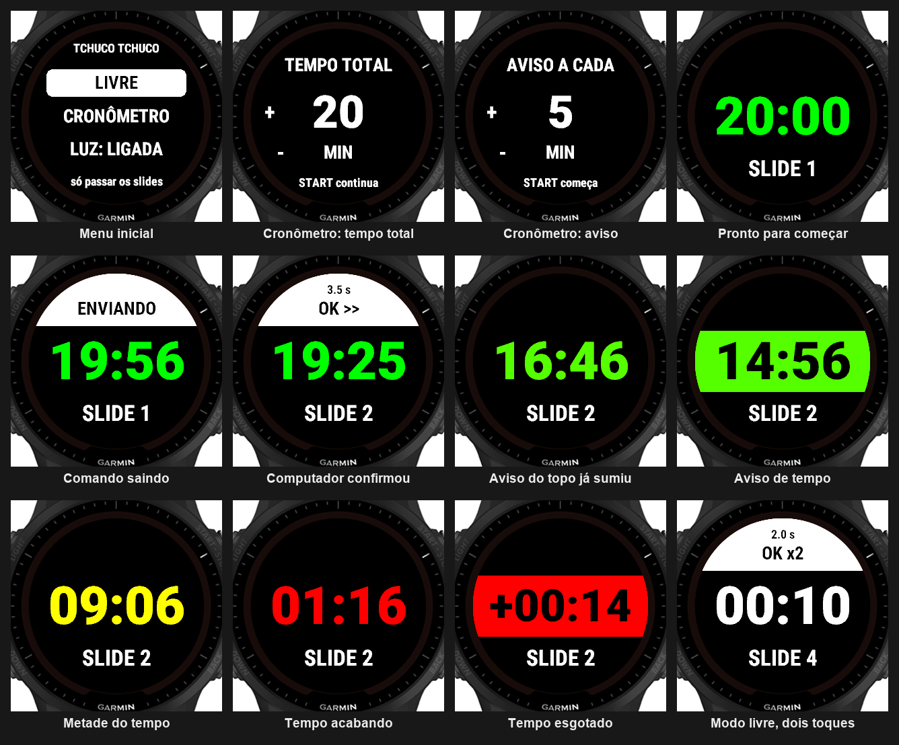

# Tchuco Tchuco

Passador de slides usando um Garmin Forerunner 955 / 955 Solar.

```
relógio (app Connect IQ)
   │  Bluetooth
   ▼
celular pareado (Garmin Connect)
   │  HTTPS
   ▼
ntfy.sh  ◄──── stream ────  computador (desktop/tchuco.py)
                             "next" → seta direita
                             "prev" → seta esquerda
                             e confirma em "<tópico>-ack"
```

O relógio e o computador podem estar em redes diferentes: o único ponto de
encontro é um tópico do [ntfy.sh](https://ntfy.sh). Não há servidor próprio,
app de celular, banco de dados nem login.

| Pasta | O que é |
|---|---|
| `watch/` | App do relógio (Connect IQ, Monkey C, alvo `fr955`) |
| `desktop/` | Script do computador (Python 3, um arquivo, Windows e macOS) |

## Como usar no relógio

O app é operado só pelos botões. Toques e deslizes na tela são ignorados, e o
app não abre telas do sistema (que aceitariam toque).



### Menu inicial

Ao abrir, o app mostra três opções; a de baixo da tela explica a que está
destacada. UP e DOWN escolhem, START confirma e BACK fecha o app.

| Opção | O que faz |
|---|---|
| LIVRE | vai direto para o passador de slides, sem limite de tempo |
| CRONÔMETRO | pergunta o tempo total e o intervalo do aviso e começa a apresentação com contagem regressiva |
| LUZ: LIGADA / AUTO | START alterna entre manter a luz do visor sempre acesa e deixar o relógio decidir |

O menu abre na última opção usada, e os tempos escolhidos ficam guardados no
relógio.

### Ajustes do cronômetro

Duas telas, uma depois da outra: **tempo total** e **aviso a cada**. UP
aumenta, DOWN diminui (o "+" e o "-" na tela ficam ao lado desses botões),
START segue para a próxima e BACK volta. Os valores vão de 1 em 1 minuto até
30, de 5 em 5 até 60 e de 15 em 15 até 180; no aviso, zero vale "SEM AVISO".

### Apresentação

| Botão | Ação |
|---|---|
| START (superior direito) | próximo slide (`next`) |
| DOWN (inferior esquerdo, o da música) | slide anterior (`prev`) |
| BACK (inferior direito) | mostra "BACK DE NOVO"; um segundo BACK em 3 s volta para o menu |
| UP (meio esquerdo) | nada |

A tela mostra o tempo, grande, e o contador de slides.

- **Modo livre:** cronômetro branco que conta para cima a partir do primeiro
  clique, sem avisos.
- **Cronômetro:** contagem regressiva a partir do primeiro clique. O número
  vai do verde ao vermelho em sete tons conforme o tempo acaba. A cada
  intervalo escolhido (quando faltam 15, 10, 5 minutos, por exemplo) o meio
  da tela acende por 3 segundos e o relógio dá três vibrações suaves. Quando
  o tempo acaba são cinco vibrações fortes, e o número passa a mostrar em
  vermelho quanto tempo passou do limite ("+00:12").

O resultado de cada comando aparece numa faixa branca com letra preta no topo
(sempre a mesma cor, para não se confundir com as cores do tempo) e some
sozinho: 3 segundos depois de um "OK" e 10 segundos depois de uma falha.

| Aviso | Significado |
|---|---|
| "ENVIANDO" | o comando está indo para o ntfy |
| "CONFIRMANDO" | o ntfy recebeu; esperando o computador responder |
| "OK >>" / "<< OK" | o computador executou; em cima, quanto tempo levou |
| "OK x2" | dois (ou mais) toques seguidos foram executados |
| "SEM PC" | o ntfy recebeu, mas nenhum computador respondeu |
| "SEM CELULAR" / "SEM INTERNET" / "ERRO HTTP" | o comando não saiu; em cima, o código do erro |

| Vibração | Quando |
|---|---|
| uma suave e curta (50 ms) por comando | o computador confirmou; dois toques seguidos dão duas |
| uma suave e mais longa (300 ms) | o envio falhou ou o computador não respondeu |
| três suaves, uma por segundo | aviso de tempo |
| cinco fortes (500 ms), uma por segundo | o tempo acabou |

## 1. O tópico (é a sua senha)

Quem souber o nome do tópico consegue passar os seus slides, então use um nome
longo e aleatório e não o coloque no git. Para gerar um:

```
python -c "import secrets; print('tchuco-' + secrets.token_hex(16))"
```

O mesmo tópico vai em dois lugares:

1. **Relógio:** copie `watch/Config.mc.exemplo` para `watch/source/Config.mc`
   (arquivo ignorado pelo git) e troque o valor de `TOPICO`. Esse é o único
   arquivo com a URL base e o tópico. Não crie outra cópia com extensão `.mc`
   dentro de `watch/`: o compilador junta todos os `.mc` da pasta.
2. **Computador:** variável de ambiente `TCHUCO_TOPICO` ou argumento do script.

As confirmações usam um segundo tópico, derivado do primeiro: `<tópico>-ack`.
Não é preciso configurar nada.

## 2. Computador

Requisitos: Python 3 (testado com o 3.13) e o pacote `pynput`.

```
python -m venv .venv
.venv\Scripts\activate          (macOS: source .venv/bin/activate)
pip install pynput
```

Para rodar (deixe a apresentação em primeiro plano, em modo de exibição):

```
# Windows (PowerShell)
$env:TCHUCO_TOPICO = "seu-topico"
python desktop\tchuco.py

# macOS
export TCHUCO_TOPICO="seu-topico"
python desktop/tchuco.py
```

Também funciona `python desktop/tchuco.py seu-topico`, mas assim o tópico fica
visível no terminal; prefira a variável de ambiente se a tela estiver sendo
projetada. `--dry-run` só imprime os comandos, sem apertar teclas (nesse modo
o `pynput` nem precisa estar instalado). `Ctrl+C` encerra.

O script só processa mensagens publicadas depois que ele conectou, reconecta
sozinho se a conexão cair e confirma cada comando executado.

**macOS:** na primeira execução, autorize o terminal em *Ajustes do Sistema →
Privacidade e Segurança → Acessibilidade*; sem isso o sistema descarta as
teclas em silêncio. Se aparecer `CERTIFICATE_VERIFY_FAILED` (Python instalado
pelo python.org), rode uma vez o `Install Certificates.command` que fica na
pasta do Python em *Aplicativos*.

## 3. Relógio

### 3.1 Instalar o SDK (uma vez)

1. Instale o Java 11 ou mais novo.
2. Em <https://developer.garmin.com/connect-iq/sdk/>, baixe o **SDK Manager**,
   extraia em uma pasta e abra.
3. Aceite o contrato e faça login com a sua conta Garmin.
4. Na aba **SDK**, baixe a versão mais recente e marque-a como SDK ativo.
5. Na aba **Devices**, baixe só o **Forerunner® 955 / Solar**. Todos os
   dispositivos juntos, com as fontes, ocupam cerca de 1,5 GB.
6. (Opcional) No VS Code, instale a extensão **Monkey C** e rode
   *Monkey C: Verify Installation*.

### 3.2 Chave de desenvolvedor (uma vez)

O compilador assina o app com uma chave RSA de 4096 bits. Guarde-a: ela não
vai para o git.

```
openssl genrsa -out watch/developer_key.pem 4096
openssl pkcs8 -topk8 -inform PEM -outform DER -in watch/developer_key.pem -out watch/developer_key.der -nocrypt
```

No Windows o `openssl` vem junto com o Git
(`C:\Program Files\Git\usr\bin\openssl.exe`). Outra opção é o comando
*Monkey C: Generate a Developer Key* do VS Code.

### 3.3 Compilar

```
# Windows (PowerShell)
$sdk = (Get-Content "$env:APPDATA\Garmin\ConnectIQ\current-sdk.cfg").Trim()
& "$sdk\bin\monkeyc.bat" -d fr955 -f watch\monkey.jungle -o watch\bin\TchucoTchuco.prg -y watch\developer_key.der -w -r

# macOS
SDK="$(cat "$HOME/Library/Application Support/Garmin/ConnectIQ/current-sdk.cfg")"
"$SDK/bin/monkeyc" -d fr955 -f watch/monkey.jungle -o watch/bin/TchucoTchuco.prg -y watch/developer_key.der -w -r
```

- `fr955` vale para o Forerunner 955 e para o 955 Solar.
- `-w` mostra os avisos do compilador; a checagem de tipos estrita já está
  ligada no `watch/monkey.jungle`.
- `-r` gera a versão enxuta, que é a que vai para o relógio. Sem o `-r` sai a
  versão de depuração, que também roda no simulador.

Com o SDK 9.3.0 o resultado esperado é `BUILD SUCCESSFUL`, sem avisos.

### 3.4 Rodar no simulador

```
# Windows (PowerShell)
& "$sdk\bin\connectiq.bat"
& "$sdk\bin\monkeydo.bat" watch\bin\TchucoTchuco.prg fr955

# macOS
"$SDK/bin/connectiq"
"$SDK/bin/monkeydo" watch/bin/TchucoTchuco.prg fr955
```

O primeiro comando abre o simulador; o segundo carrega o app e fica mostrando
o que ele imprime (por exemplo `envio de next: 200` e `confirmado em 2063 ms`).
Clique com o mouse nos botões do relógio desenhado na tela. O simulador faz as
requisições HTTPS de verdade a partir do computador, então o caminho inteiro é
testado, menos o Bluetooth e o celular.

Úteis no simulador:

- *Settings → Connection Type → BLE → Not Connected*: simula o celular
  desconectado (o app mostra "SEM CELULAR", código -104).
- *File → View HTTP Traffic*: mostra as requisições feitas pelo app.

### 3.5 Copiar para o relógio

1. Conecte o relógio no USB.
2. Copie `watch/bin/TchucoTchuco.prg` para a pasta `GARMIN/APPS` do relógio,
   por cima da versão anterior, se houver. O 955 aparece como dispositivo de
   mídia (MTP): no Windows ele surge no Explorador de Arquivos; no macOS é
   preciso um programa de MTP, como o OpenMTP, e o Garmin Express precisa
   estar fechado.
3. Desconecte o cabo. O app aparece na lista de atividades e apps.

Para ver os `System.println` do app no relógio, crie antes um arquivo vazio
com o mesmo nome do `.prg` na pasta de logs: `GARMIN/APPS/LOGS/TchucoTchuco.TXT`.

## Como o relógio fala com o ntfy

### Envio do comando

O plano inicial era um `POST` com o texto `next` para `https://ntfy.sh/<tópico>`.
No fr955 isso não é possível, e o formato escolhido foi o seguinte:

- **Requisição:** `POST https://ntfy.sh/` com `Content-Type: application/json`
  e o corpo `{"topic": "<tópico>", "message": "next"}` (o "Publish as JSON" do
  ntfy, que exige a URL raiz, e não a URL do tópico).
- **Resposta:** o ntfy devolve a mensagem publicada como objeto JSON, com
  `Content-Type: application/json`.

Motivos:

- O `Communications.makeWebRequest` recebe os dados como um dicionário e os
  serializa como JSON ou como formulário. Corpo de texto puro só existe com a
  opção `:body`, disponível a partir do Connect IQ 6.0.3; o 955 está na API 5.2.
- Sem informar o `Content-Type`, um `POST` sai como
  `application/x-www-form-urlencoded`, e o ntfy usa o corpo inteiro como texto
  da mensagem: chegaria `message=next` em vez de `next`.
- Com `:responseType => HTTP_RESPONSE_CONTENT_TYPE_JSON`, o Connect IQ exige
  que a resposta venha como `application/json` com um JSON válido; senão o
  callback recebe o erro -400 ou -1002 mesmo com a mensagem publicada.

Conferido com `curl` no ntfy.sh:

| Requisição | Mensagem publicada |
|---|---|
| JSON na URL raiz (formato usado) | `next` |
| Formulário `message=next` na URL do tópico | `message=next` |
| JSON `{"message":"next"}` na URL do tópico | `{"message":"next"}` |

### Confirmação pelo computador

O ntfy aceitar o comando não quer dizer que existe um computador ouvindo. Por
isso, depois de apertar a tecla, o script publica o id do comando no tópico
`<tópico>-ack`, e o relógio consulta esse tópico:

- **Requisição:** `GET https://ntfy.sh/<tópico>-ack/raw?poll=1&since=30s`.
- **Resposta:** texto puro (`text/plain`), um id por linha, que o Connect IQ
  aceita com `HTTP_RESPONSE_CONTENT_TYPE_TEXT_PLAIN`. A mesma consulta em
  JSON não serve: ela vem como `application/x-ndjson`.

O relógio espera 0,7 s, consulta e repete até 3 vezes. Se o id aparecer,
mostra "OK"; se não, "SEM PC". Um clique novo tem prioridade: ele é enviado
antes de terminar a conferência do anterior, e a conferência passa a valer
para o último comando.

Custo: o "OK" aparece depois. No simulador, com o ntfy.sh real, a confirmação
levou de 2,0 a 3,5 s, contra 0,7 s do envio sozinho; o slide em si muda no
mesmo instante de antes. Parte dessa espera é do próprio ntfy.sh, que leva de
0,1 a 1,4 s para tornar uma mensagem publicada visível nas consultas.

## Notificações

Um app Connect IQ não consegue bloquear as notificações do relógio nem ligar
o modo Não Perturbe. O que o app faz é gravar uma "atividade" enquanto está
aberto (por isso a permissão `Fit` no manifest): com uma atividade em
andamento, o relógio passa a seguir a regra de notificações **durante a
atividade**, que pode ser deixada como desligada nas configurações de
notificações do relógio. Ao fechar o app a atividade é descartada, então nada
vai para o Garmin Connect.

Isso ainda não foi conferido num relógio de verdade. Se as notificações
continuarem aparecendo, a saída é ligar o Não Perturbe no menu de controles
(segurando o botão LIGHT) antes de apresentar.

## Roteiro de teste

**1. Só o computador, com curl**

```
python desktop/tchuco.py --dry-run
```

Em outro terminal (no PowerShell use `curl.exe`, porque `curl` é um apelido de
outro comando):

```
curl.exe -d "next" "https://ntfy.sh/$env:TCHUCO_TOPICO"      (PowerShell)
curl -d "prev" "https://ntfy.sh/$TCHUCO_TOPICO"              (macOS)
```

O script deve imprimir `next -> seta direita` e `prev -> seta esquerda`. Uma
mensagem publicada antes de o script conectar não pode aparecer. Para ver as
confirmações que ele publicou:

```
curl.exe "https://ntfy.sh/$env:TCHUCO_TOPICO-ack/raw?poll=1&since=1m"
```

**2. Computador apertando teclas**

Abra a apresentação em modo de exibição, rode o script sem `--dry-run` e
repita os comandos `curl`: o slide deve avançar e voltar.

**3. Simulador**

Com o script rodando em `--dry-run`, abra o app no simulador (seção 3.4):

- no menu, UP e DOWN mudam a opção destacada; START em LIVRE abre a
  apresentação com o cronômetro em 00:00;
- START: o terminal do `monkeydo` mostra `envio de next: 200` e depois
  `confirmado em ... ms (1)`; o script imprime `next -> seta direita`; a faixa
  branca mostra "ENVIANDO", "CONFIRMANDO" e "OK >>", e some em 3 segundos;
- dois START seguidos: `confirmado em ... ms (2)` e "OK x2";
- DOWN: `prev`, e o contador desce; UP não faz nada;
- com o script fechado: depois de três consultas, "SEM PC";
- com *BLE → Not Connected*: "SEM CELULAR";
- clicar ou arrastar o mouse sobre a tela do relógio não faz nada;
- BACK mostra "BACK DE NOVO"; outro BACK em 3 s volta para o menu;
- no menu, CRONÔMETRO: escolha um tempo total curto e um aviso, e aperte START
  na apresentação: o número começa verde, acende nos avisos, fica vermelho e,
  no fim, passa a mostrar "+MM:SS";
- no menu, BACK fecha o app e o terminal mostra `atividade descartada`.

**4. Relógio de verdade**

Com o celular por perto, Bluetooth ligado e o Garmin Connect aberto:

- no modo livre, START avança e DOWN volta, com uma vibração curta quando o
  computador confirma; anote o tempo que aparece em cima do "OK";
- dois toques seguidos: duas vibrações e "OK x2";
- com o script fechado: "SEM PC" e vibração mais longa;
- com o Bluetooth do celular desligado: "SEM CELULAR";
- com o celular em modo avião e Bluetooth ligado: uma mensagem de falha com o
  código do erro;
- toques e deslizes na tela não fazem nada;
- com LUZ: LIGADA, a luz do visor fica acesa o tempo todo;
- no cronômetro, com 2 minutos de tempo total e aviso a cada 1, sinta as três
  vibrações suaves e as cinco fortes do fim;
- com "durante a atividade" desligado nas notificações do relógio, mande uma
  mensagem para o celular com o app aberto: ela não deve aparecer;
- depois de fechar o app, confira que nenhuma atividade foi salva;
- deixe o app aberto pelo tempo de uma apresentação e confira se ele
  continua na tela.

## Limitações conhecidas

- **Latência.** Cada clique passa por Bluetooth, celular, internet e ntfy.
  Não é instantâneo e varia com o celular e a rede; se o Garmin Connect
  estiver "dormindo" no celular, o primeiro clique pode demorar mais.
- **O "OK" demora mais que o slide.** O slide muda quando o comando chega ao
  computador; o "OK" só aparece depois da confirmação, alguns segundos mais
  tarde.
- **Depende de internet nos dois lados** e do ntfy.sh estar no ar. Não há
  modo offline.
- **Envio pendurado.** Quem decide quando desistir de uma requisição é o
  sistema, não o app. No simulador, um servidor que não responde levou 21
  segundos para virar erro; nesse intervalo a faixa fica amarela.
- **Fila de um comando.** Enquanto uma requisição está em andamento, só o
  último clique fica guardado; três cliques muito rápidos viram dois comandos.
- **O contador de slides é do relógio.** Ele soma os comandos confirmados pelo
  computador. Começa em 1 e não sabe quantos slides existem.
- **Limites do ntfy.sh gratuito** (por endereço IP): 250 mensagens por dia,
  rajada de 60 requisições e depois uma a cada 5 segundos, mensagens de até
  4.096 bytes, 30 conexões simultâneas. Cada clique custa ao celular um envio
  e de uma a três consultas, e ao computador um envio de confirmação. Se o
  celular e o computador saem para a internet pelo mesmo endereço, os dois
  dividem o limite, que cai para cerca de 125 cliques por dia. Ao estourar, o
  relógio mostra "ERRO HTTP" com o código 429.
- **O tópico é público.** Quem souber o nome pode publicar (e apertar as setas
  no seu computador), escutar ou forjar confirmações. Troque o tópico se ele
  vazar. O script só aceita `next` e `prev`.
- **Cliques feitos durante uma queda do computador são descartados**, de
  propósito, para os slides não pularem sozinhos na reconexão. As mensagens
  ficam 12 horas no cache do ntfy, mas o script nunca lê o cache.
- **Queda silenciosa.** Se a conexão do computador morrer sem aviso, o script
  pode levar até 60 segundos para perceber e reconectar; nesse intervalo o
  relógio mostra "SEM PC".
- **As teclas vão para a janela em primeiro plano.** A apresentação precisa
  estar em foco. No Windows, se o programa da apresentação estiver rodando
  como administrador, o script também precisa estar.
- **macOS:** exige a permissão de Acessibilidade para o terminal.
- **O computador não pode entrar em suspensão**; o script não impede isso.
- **Vibração.** Segundo a documentação da Garmin, nos Forerunner o app não
  controla a intensidade da vibração. O app pede 25% nas suaves e 100% nas
  fortes, mas a diferença que o relógio garante é a duração (50 ms contra
  500 ms). A mesma documentação diz que o Forerunner não aceita padrões de
  vibração; por isso as vibrações dos avisos saem uma por segundo, cada uma
  como um pedido separado.
- **Notificações.** O app não consegue escondê-las diretamente; a gravação de
  atividade é uma tentativa ainda não conferida no relógio (veja a seção
  Notificações). Enquanto o app está aberto o relógio fica com uma atividade
  em andamento, que é descartada ao sair.
- **Avisos de tempo só com a tela do app aberta.** Eles são disparados pelo
  redesenho de 1 segundo da tela.
- **Luz sempre acesa gasta bateria.** Com LUZ: LIGADA o app renova a luz do
  visor a cada segundo; em LUZ: AUTO vale a configuração do relógio. A
  documentação da Garmin diz que a luz sempre respeita as configurações do
  aparelho, então falta conferir no relógio se ela fica mesmo acesa.
- **Toque.** No 955, deslizar o dedo para a direita chega ao app como o botão
  BACK. O app separa os dois casos (só o botão físico gera o evento de "tecla
  apertada"); isso funcionou no simulador e ainda precisa ser conferido no
  relógio. Segurar os botões aciona os atalhos do próprio relógio.
- **O simulador não reproduz tudo.** Ele não tem Bluetooth, celular nem motor
  de vibração, e devolve 404 quando o servidor é inalcançável, em vez do
  código de erro que o relógio daria.
