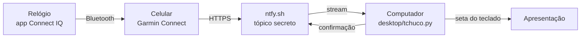
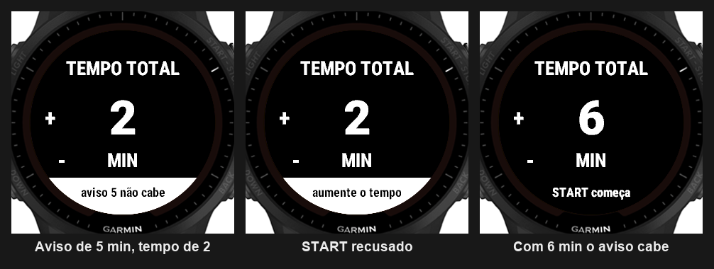

<p align="center">
  
</p>

<h1 align="center">Tchuco Tchuco</h1>

<p align="center">
  Passe os slides pelo relógio.<br>
  Um Garmin Forerunner 955 vira o controle da sua apresentação,
  com cronômetro e avisos de tempo no pulso.
</p>

<p align="center">
  <em>Slide clicker for the Garmin Forerunner 955. This README is written in
  Brazilian Portuguese.</em>
</p>


Você aperta START no relógio e o slide avança no computador. O relógio não
fala direto com o computador: o comando sai pelo celular, passa por um tópico
do [ntfy.sh](https://ntfy.sh) e chega a um script Python que aperta a seta do
teclado. Por isso os dois podem estar em redes diferentes, e não existe
servidor próprio, app de celular, banco de dados nem login.

- **Só botões.** START avança e DOWN volta. A tela sensível ao toque é
  ignorada, para um esbarrão não passar slide.
- **Confirmação no pulso.** O "OK" e a vibração só vêm depois que o
  computador executou o comando.
- **Dois modos.** Livre, com um cronômetro que conta para cima, ou cronômetro,
  com contagem regressiva que vai do verde ao vermelho e cinco vibrações
  fortes no fim.
- **Avisos de tempo opcionais.** Três vibrações suaves a cada intervalo que
  você escolher.
- **Qualquer programa de slides.** O script só aperta as setas do teclado, na
  janela que estiver em primeiro plano.

## Índice

- [Como funciona](#como-funciona)
- [O que você precisa](#o-que-você-precisa)
- [Instalação](#instalação)
- [Como usar](#como-usar)
- [Notificações durante a apresentação](#notificações-durante-a-apresentação)
- [Solução de problemas](#solução-de-problemas)
- [Roteiro de teste](#roteiro-de-teste)
- [Por dentro](#por-dentro)
- [Limitações conhecidas](#limitações-conhecidas)
- [Estado do projeto](#estado-do-projeto)
- [Contribuindo](#contribuindo)

## Como funciona



1. O app do relógio manda `next` ou `prev` pelo celular pareado (Garmin
   Connect, via Bluetooth).
2. O celular publica o comando, por HTTPS, num tópico do ntfy.sh, um serviço
   público de mensagens. O nome do tópico é o segredo que une os dois lados.
3. O script do computador escuta esse tópico, aperta a seta direita ou a
   esquerda e publica uma confirmação em `<tópico>-ack`.
4. O relógio consulta a confirmação e só então mostra "OK".

| Pasta | O que é |
|---|---|
| `watch/` | App do relógio (Connect IQ, Monkey C, alvo `fr955`) |
| `desktop/` | Script do computador (Python 3, um arquivo) |
| `docs/` | Imagens deste README |

## O que você precisa

- **Relógio:** Garmin Forerunner 955 ou 955 Solar.
- **Celular** pareado com o relógio, com o app Garmin Connect e internet.
- **Computador** com Windows ou macOS, Python 3 e internet. É ele que mostra
  os slides.
- **Para compilar o app:** Java 11 ou mais novo, o Connect IQ SDK (gratuito,
  pede uma conta Garmin), o `openssl` e um cabo USB.

Não é preciso criar conta no ntfy.sh.

O app foi escrito para o 955. Outros relógios com Connect IQ exigiriam incluir
o produto em `watch/manifest.xml` e conferir tela e botões; isso não foi
testado.

## Instalação

São dez passos: os três primeiros cuidam do computador, e do 4 ao 9, do
relógio. Todos os comandos são executados na pasta do projeto.

### 1. Baixe o projeto

Clone este repositório (botão **Code** do GitHub) ou baixe o ZIP, e abra um
terminal na pasta do projeto.

### 2. Crie o seu tópico

O tópico funciona como senha: quem souber o nome consegue passar os seus
slides. Use um nome longo e aleatório e não o coloque no git. Para gerar um:

```
python -c "import secrets; print('tchuco-' + secrets.token_hex(16))"
```

Guarde o resultado. O mesmo tópico vai no computador (passo 3) e no relógio
(passo 6).

### 3. Prepare o computador

Requisitos: Python 3 (testado com o 3.13) e o pacote `pynput`.

```
python -m venv .venv
.venv\Scripts\activate          (macOS: source .venv/bin/activate)
pip install pynput
```

Informe o tópico e rode o script em modo de ensaio, que só imprime os
comandos, sem apertar teclas:

```
# Windows (PowerShell)
$env:TCHUCO_TOPICO = "seu-topico"
python desktop\tchuco.py --dry-run

# macOS
export TCHUCO_TOPICO="seu-topico"
python desktop/tchuco.py --dry-run
```

Em outro terminal, com a mesma variável definida, publique um comando de
teste (no PowerShell use `curl.exe`, porque `curl` é um apelido de outro
comando):

```
curl.exe -d "next" "https://ntfy.sh/$env:TCHUCO_TOPICO"      (PowerShell)
curl -d "next" "https://ntfy.sh/$TCHUCO_TOPICO"              (macOS)
```

O script deve mostrar algo assim:

```
12:00:00 tópico tchu... em https://ntfy.sh (dry-run: nenhuma tecla é apertada)
12:00:00 conectado; aguardando comandos (Ctrl+C sai)
12:00:07 next -> seta direita
```

Para valer, rode sem o `--dry-run` e deixe a apresentação em primeiro plano,
em modo de exibição. `Ctrl+C` encerra.

Também funciona `python desktop/tchuco.py seu-topico`, mas assim o tópico fica
visível no terminal; prefira a variável de ambiente se a tela estiver sendo
projetada.

**macOS:** na primeira execução, autorize o terminal em *Ajustes do Sistema →
Privacidade e Segurança → Acessibilidade*; sem isso o sistema descarta as
teclas em silêncio. Se aparecer `CERTIFICATE_VERIFY_FAILED` (Python instalado
pelo python.org), rode uma vez o `Install Certificates.command` que fica na
pasta do Python em *Aplicativos*.

### 4. Instale o Connect IQ SDK

1. Instale o Java 11 ou mais novo.
2. Em <https://developer.garmin.com/connect-iq/sdk/>, baixe o **SDK Manager**,
   extraia em uma pasta e abra.
3. Aceite o contrato e faça login com a sua conta Garmin.
4. Na aba **SDK**, baixe a versão mais recente e marque-a como SDK ativo.
5. Na aba **Devices**, baixe só o **Forerunner® 955 / Solar**. Todos os
   dispositivos juntos, com as fontes, ocupam cerca de 1,5 GB.
6. (Opcional) No VS Code, instale a extensão **Monkey C** e rode
   *Monkey C: Verify Installation*.

### 5. Gere a chave de desenvolvedor

O compilador assina o app com uma chave RSA de 4096 bits. Ela é sua e não vai
para o git.

```
openssl genrsa -out watch/developer_key.pem 4096
openssl pkcs8 -topk8 -inform PEM -outform DER -in watch/developer_key.pem -out watch/developer_key.der -nocrypt
```

No Windows o `openssl` vem junto com o Git
(`C:\Program Files\Git\usr\bin\openssl.exe`). Outra opção é o comando
*Monkey C: Generate a Developer Key* do VS Code.

### 6. Informe o tópico ao app

Copie o arquivo de exemplo e troque o valor de `TOPICO` pelo tópico do
passo 2:

```
# Windows (PowerShell)
Copy-Item watch\Config.mc.exemplo watch\source\Config.mc

# macOS
cp watch/Config.mc.exemplo watch/source/Config.mc
```

`watch/source/Config.mc` é ignorado pelo git e é o único arquivo com a URL
base e o tópico. Não crie outra cópia com extensão `.mc` dentro de `watch/`:
o compilador junta todos os `.mc` da pasta.

### 7. Compile

```
# Windows (PowerShell)
$sdk = (Get-Content "$env:APPDATA\Garmin\ConnectIQ\current-sdk.cfg").Trim()
& "$sdk\bin\monkeyc.bat" -d fr955 -f watch\monkey.jungle -o watch\bin\TchucoTchuco.prg -y watch\developer_key.der -w -r

# macOS
SDK="$(cat "$HOME/Library/Application Support/Garmin/ConnectIQ/current-sdk.cfg")"
"$SDK/bin/monkeyc" -d fr955 -f watch/monkey.jungle -o watch/bin/TchucoTchuco.prg -y watch/developer_key.der -w -r
```

- `fr955` vale para o Forerunner 955 e para o 955 Solar.
- `-w` mostra os avisos do compilador; a checagem de tipos estrita já está
  ligada no `watch/monkey.jungle`.
- `-r` gera a versão enxuta, que é a que vai para o relógio. Sem o `-r` sai a
  versão de depuração, que também roda no simulador.

Com o SDK 9.3.0 o resultado esperado é `BUILD SUCCESSFUL`, sem avisos.

### 8. Teste no simulador (opcional)

```
# Windows (PowerShell)
& "$sdk\bin\connectiq.bat"
& "$sdk\bin\monkeydo.bat" watch\bin\TchucoTchuco.prg fr955

# macOS
"$SDK/bin/connectiq"
"$SDK/bin/monkeydo" watch/bin/TchucoTchuco.prg fr955
```

O primeiro comando abre o simulador; o segundo carrega o app e fica mostrando
o que ele imprime (por exemplo `envio de next: 200` e `confirmado em 2063 ms`).
Clique com o mouse nos botões do relógio desenhado na tela. O simulador faz as
requisições HTTPS de verdade a partir do computador, então o caminho inteiro é
testado, menos o Bluetooth e o celular.

Úteis no simulador:

- *Settings → Connection Type → BLE → Not Connected*: simula o celular
  desconectado (o app mostra "SEM CELULAR", código -104).
- *File → View HTTP Traffic*: mostra as requisições feitas pelo app.

### 9. Copie para o relógio

1. Conecte o relógio no USB.
2. Copie `watch/bin/TchucoTchuco.prg` para a pasta `GARMIN/APPS` do relógio,
   por cima da versão anterior, se houver. O 955 aparece como dispositivo de
   mídia (MTP): no Windows ele surge no Explorador de Arquivos; no macOS é
   preciso um programa de MTP, como o OpenMTP, e o Garmin Express precisa
   estar fechado.
3. Desconecte o cabo. O app aparece na lista de atividades e apps.

Para ver os `System.println` do app no relógio, crie antes um arquivo vazio
com o mesmo nome do `.prg` na pasta de logs: `GARMIN/APPS/LOGS/TchucoTchuco.TXT`.

### 10. Apresente

1. No computador, rode o script (sem `--dry-run`) e ponha a apresentação em
   primeiro plano, em modo de exibição.
2. Deixe o celular por perto, com Bluetooth e internet, e o Garmin Connect
   aberto.
3. No relógio, abra o Tchuco Tchuco, escolha LIVRE e aperte START: o slide
   avança, e o relógio vibra e mostra "OK >>".

Se algo não responder, veja [Solução de problemas](#solução-de-problemas).

## Como usar

O app é operado só pelos botões. Toques e deslizes na tela são ignorados, e o
app não abre telas do sistema (que aceitariam toque).

### Menu inicial

Ao abrir, o app mostra quatro opções; a linha de baixo da tela explica a que
está destacada. UP e DOWN escolhem, START confirma e BACK fecha o app.

| Opção | O que faz |
|---|---|
| LIVRE | vai direto para o passador de slides, sem limite de tempo |
| CRONÔMETRO | pergunta o tempo total e abre a apresentação com a contagem regressiva já correndo |
| AVISO: NÃO / N MIN | liga ou desliga os avisos de tempo e define o intervalo; vale para os dois modos |
| LUZ: LIGADA / AUTO | START alterna entre manter a luz do visor sempre acesa e deixar o relógio decidir |

O menu abre no último modo usado, e todas as escolhas ficam guardadas no
relógio.

### Ajustes

- **Tempo total** (ao escolher CRONÔMETRO): UP aumenta e DOWN diminui (o "+"
  e o "-" na tela ficam ao lado desses botões); START começa a apresentação.
- **Avisos** (ao escolher AVISO): primeiro a pergunta NÃO ou SIM; em SIM,
  aparece **aviso a cada**, ajustado do mesmo jeito, e START grava.

Os minutos vão de 1 em 1 até 30, de 5 em 5 até 60 e de 15 em 15 até 180.
BACK volta uma tela sem gravar.

No cronômetro o aviso precisa caber no tempo: o intervalo tem de ser menor que
o tempo total. Quando não cabe (2 minutos de tempo com aviso a cada 5, por
exemplo), a tela do tempo total mostra na hora a faixa branca "aviso 5 não
cabe" e o START fica travado: o relógio vibra e a faixa passa a dizer "aumente
o tempo". Para seguir, aumente o tempo total até caber, ou volte com BACK e
mude ou desligue o aviso. O menu mostra o mesmo "aviso 5 não cabe" ao destacar
CRONÔMETRO. No modo livre não há esse limite.



### Apresentação

| Botão | Ação |
|---|---|
| START (superior direito) | próximo slide (`next`) |
| DOWN (inferior esquerdo, o da música) | slide anterior (`prev`) |
| BACK (inferior direito) | mostra "BACK DE NOVO"; um segundo BACK em 3 s volta para o menu |
| UP (meio esquerdo) | nada |

A tela mostra o tempo, grande, e o contador de slides.

- **Modo livre:** cronômetro branco que conta para cima a partir do primeiro
  slide passado.
- **Cronômetro:** contagem regressiva que começa assim que a apresentação
  abre, sem precisar passar slide. O número vai do verde ao vermelho em sete
  tons conforme o tempo acaba. Quando o tempo acaba são cinco vibrações
  fortes, e o número passa a mostrar em vermelho quanto tempo passou do
  limite ("+00:12").
- **Avisos de tempo** (opcionais, nos dois modos): o meio da tela acende por
  3 segundos e o relógio dá três vibrações suaves. No modo livre isso
  acontece a cada intervalo escolhido; no cronômetro, quando faltam múltiplos
  do intervalo (faltam 15, 10, 5 minutos, por exemplo).

O resultado de cada comando aparece numa faixa branca com letra preta no topo
(sempre a mesma cor, para não se confundir com as cores do tempo) e some
sozinho: 3 segundos depois de um "OK" e 10 segundos depois de uma falha.

| Aviso | Significado |
|---|---|
| "ENVIANDO" | o comando está indo para o ntfy |
| "CONFIRMANDO" | o ntfy recebeu; esperando o computador responder |
| "OK >>" / "<< OK" | o computador executou; em cima, quanto tempo levou |
| "OK x2" | dois (ou mais) toques seguidos foram executados |
| "SEM PC" | o ntfy recebeu, mas nenhum computador respondeu |
| "SEM CELULAR" / "SEM INTERNET" / "ERRO HTTP" | o comando não saiu; em cima, o código do erro |

| Vibração | Quando |
|---|---|
| uma suave e curta (50 ms) por comando | o computador confirmou; dois toques seguidos dão duas |
| uma suave e mais longa (300 ms) | o envio falhou, o computador não respondeu ou o START estava travado |
| três suaves, uma por segundo | aviso de tempo |
| cinco fortes (500 ms), uma por segundo | o tempo acabou |

## Notificações durante a apresentação

O app não consegue esconder as notificações do relógio. A API do Connect IQ
não tem como bloqueá-las nem como ligar o Não Perturbe; ela só permite ler se
ele está ligado. Se uma mensagem chegar no meio da apresentação, o relógio
mostra o aviso dele por cima do app, e enquanto esse aviso está na tela os
botões podem agir sobre ele em vez de passar o slide.

O jeito é silenciar as notificações no próprio relógio antes de começar:

- **Não Perturbe.** Segure LIGHT para abrir o menu de controles e ative o Não
  Perturbe. Segundo o [manual do 955][manual-controles], esse modo escurece a
  tela e desliga alertas e notificações. Confira no seu relógio se as
  vibrações do Tchuco Tchuco e a luz do visor continuam como você espera com
  ele ligado.
- **Desligar as notificações do celular.** No menu do relógio, em
  *Conectividade → Telefone → Notificações inteligentes → Estado*
  ([*Connectivity → Phone → Smart Notifications → Status*][manual-notificacoes]
  no relógio em inglês), escolha desligado e religue depois. Os nomes mudam
  um pouco conforme o idioma e a versão do relógio.

[manual-controles]: https://www8.garmin.com/manuals/webhelp/GUID-9D99A9D4-467A-4F1A-A0EA-023184FEA3DD/EN-US/GUID-700E76C4-F7E2-4984-8199-D59D6A31DFB9.html
[manual-notificacoes]: https://www8.garmin.com/manuals/webhelp/GUID-9D99A9D4-467A-4F1A-A0EA-023184FEA3DD/EN-US/GUID-599D739A-21A7-4EF2-98F4-29258D407B47.html

## Solução de problemas

| O que aparece | Causa provável | O que fazer |
|---|---|---|
| "SEM CELULAR" (código -104) | o relógio não está conectado ao celular | ligue o Bluetooth, aproxime o celular e abra o Garmin Connect |
| "SEM INTERNET" (código zero ou negativo) | o celular não chegou ao ntfy.sh | confira a internet do celular |
| "ERRO HTTP" com o código 429 | limite gratuito do ntfy.sh | espere alguns minutos (veja [Limitações conhecidas](#limitações-conhecidas)) |
| "SEM PC" | o ntfy recebeu, mas nenhum computador confirmou | confira se o script está rodando, com internet e com o mesmo tópico do relógio |
| "OK" no relógio, mas o slide não muda | a tecla foi para outra janela | deixe a apresentação em primeiro plano; no macOS, autorize o terminal em Acessibilidade; no Windows, se o programa da apresentação roda como administrador, rode o script como administrador também |
| o script pede para informar o tópico | faltou o tópico | defina `TCHUCO_TOPICO` ou passe o tópico como argumento |
| o script mostra `conexão caiu` e `reconectando` | o computador ficou sem internet | ele tenta de novo sozinho, com espera de até 15 segundos |
| `CERTIFICATE_VERIFY_FAILED` no macOS | Python do python.org sem os certificados | rode o `Install Certificates.command` da pasta do Python |
| o compilador reclama de `TOPICO` redefinido | há mais de um `.mc` de configuração dentro de `watch/` | deixe só o `watch/source/Config.mc` |
| o compilador não encontra `Config` | faltou criar `watch/source/Config.mc` | refaça o passo 6 |
| START não começa o cronômetro | o aviso não cabe no tempo total | aumente o tempo, ou mude ou desligue o aviso |
| o app não aparece no relógio | o `.prg` foi para a pasta errada | copie para `GARMIN/APPS` |

## Roteiro de teste

**1. Só o computador, com curl**

```
python desktop/tchuco.py --dry-run
```

Em outro terminal:

```
curl.exe -d "next" "https://ntfy.sh/$env:TCHUCO_TOPICO"      (PowerShell)
curl -d "prev" "https://ntfy.sh/$TCHUCO_TOPICO"              (macOS)
```

O script deve imprimir `next -> seta direita` e `prev -> seta esquerda`. Uma
mensagem publicada antes de o script conectar não pode aparecer. Para ver as
confirmações que ele publicou:

```
curl.exe "https://ntfy.sh/$env:TCHUCO_TOPICO-ack/raw?poll=1&since=1m"
```

**2. Computador apertando teclas**

Abra a apresentação em modo de exibição, rode o script sem `--dry-run` e
repita os comandos `curl`: o slide deve avançar e voltar.

**3. Simulador**

Com o script rodando em `--dry-run`, abra o app no simulador (passo 8):

- no menu, UP e DOWN mudam a opção destacada; START em LIVRE abre a
  apresentação com o cronômetro em 00:00;
- START: o terminal do `monkeydo` mostra `envio de next: 200` e depois
  `confirmado em ... ms (1)`; o script imprime `next -> seta direita`; a faixa
  branca mostra "ENVIANDO", "CONFIRMANDO" e "OK >>", e some em 3 segundos;
- dois START seguidos: `confirmado em ... ms (2)` e "OK x2";
- DOWN: `prev`, e o contador desce; UP não faz nada;
- com o script fechado: depois de três consultas, "SEM PC";
- com *BLE → Not Connected*: "SEM CELULAR";
- clicar ou arrastar o mouse sobre a tela do relógio não faz nada;
- BACK mostra "BACK DE NOVO"; outro BACK em 3 s volta para o menu;
- no menu, AVISO: escolha SIM e um intervalo curto; depois CRONÔMETRO, com um
  tempo total maior que o intervalo: a contagem começa sozinha, o número
  começa verde, acende nos avisos, fica vermelho e, no fim, passa a mostrar
  "+MM:SS";
- com AVISO em NÃO, o cronômetro só dá o alarme do fim; no modo LIVRE com
  AVISO ligado, o meio da tela acende a cada intervalo depois do primeiro
  START;
- com AVISO a cada 5 minutos, escolha CRONÔMETRO e baixe o tempo total: com 5
  ou menos aparece a faixa "aviso 5 não cabe", e START não começa (a faixa
  passa a dizer "aumente o tempo"); com 6 volta "START começa";
- no menu, BACK fecha o app.

**4. Relógio de verdade**

Com o celular por perto, Bluetooth ligado e o Garmin Connect aberto:

- no modo livre, START avança e DOWN volta, com uma vibração curta quando o
  computador confirma; anote o tempo que aparece em cima do "OK";
- dois toques seguidos: duas vibrações e "OK x2";
- com o script fechado: "SEM PC" e vibração mais longa;
- com o Bluetooth do celular desligado: "SEM CELULAR";
- com o celular em modo avião e Bluetooth ligado: uma mensagem de falha com o
  código do erro;
- toques e deslizes na tela não fazem nada;
- com LUZ: LIGADA, a luz do visor fica acesa o tempo todo;
- com AVISO a cada 1 minuto e CRONÔMETRO de 2 minutos, a contagem começa
  sozinha; sinta as três vibrações suaves e as cinco fortes do fim;
- com o Não Perturbe ligado, confira se as vibrações do app continuam
  chegando;
- deixe o app aberto pelo tempo de uma apresentação e confira se ele
  continua na tela.

## Por dentro

### Envio do comando

O plano inicial era um `POST` com o texto `next` para `https://ntfy.sh/<tópico>`.
No fr955 isso não é possível, e o formato escolhido foi o seguinte:

- **Requisição:** `POST https://ntfy.sh/` com `Content-Type: application/json`
  e o corpo `{"topic": "<tópico>", "message": "next"}` (o "Publish as JSON" do
  ntfy, que exige a URL raiz, e não a URL do tópico).
- **Resposta:** o ntfy devolve a mensagem publicada como objeto JSON, com
  `Content-Type: application/json`.

Motivos:

- O `Communications.makeWebRequest` recebe os dados como um dicionário e os
  serializa como JSON ou como formulário. Corpo de texto puro só existe com a
  opção `:body`, disponível a partir do Connect IQ 6.0.3; o 955 está na API 5.2.
- Sem informar o `Content-Type`, um `POST` sai como
  `application/x-www-form-urlencoded`, e o ntfy usa o corpo inteiro como texto
  da mensagem: chegaria `message=next` em vez de `next`.
- Com `:responseType => HTTP_RESPONSE_CONTENT_TYPE_JSON`, o Connect IQ exige
  que a resposta venha como `application/json` com um JSON válido; senão o
  callback recebe o erro -400 ou -1002 mesmo com a mensagem publicada.

Conferido com `curl` no ntfy.sh:

| Requisição | Mensagem publicada |
|---|---|
| JSON na URL raiz (formato usado) | `next` |
| Formulário `message=next` na URL do tópico | `message=next` |
| JSON `{"message":"next"}` na URL do tópico | `{"message":"next"}` |

### Confirmação pelo computador

O ntfy aceitar o comando não quer dizer que existe um computador ouvindo. Por
isso, depois de apertar a tecla, o script publica o id do comando no tópico
`<tópico>-ack`, e o relógio consulta esse tópico:

- **Requisição:** `GET https://ntfy.sh/<tópico>-ack/raw?poll=1&since=30s`.
- **Resposta:** texto puro (`text/plain`), um id por linha, que o Connect IQ
  aceita com `HTTP_RESPONSE_CONTENT_TYPE_TEXT_PLAIN`. A mesma consulta em
  JSON não serve: ela vem como `application/x-ndjson`.

O relógio espera 0,7 s, consulta e repete até 3 vezes. Se o id aparecer,
mostra "OK"; se não, "SEM PC". Um clique novo tem prioridade: ele é enviado
antes de terminar a conferência do anterior, e a conferência passa a valer
para o último comando.

Custo: o "OK" aparece depois. No simulador, com o ntfy.sh real, a confirmação
levou de 2,0 a 3,5 s, contra 0,7 s do envio sozinho; o slide em si muda no
mesmo instante de antes. Parte dessa espera é do próprio ntfy.sh, que leva de
0,1 a 1,4 s para tornar uma mensagem publicada visível nas consultas.

### O script do computador

O script só processa mensagens publicadas depois que ele conectou, reconecta
sozinho se a conexão cair, confirma cada comando executado e só aceita `next`
e `prev`. O tópico nunca aparece inteiro no terminal: o log mostra só os
quatro primeiros caracteres.

## Limitações conhecidas

- **Latência.** Cada clique passa por Bluetooth, celular, internet e ntfy.
  Não é instantâneo e varia com o celular e a rede; se o Garmin Connect
  estiver "dormindo" no celular, o primeiro clique pode demorar mais.
- **O "OK" demora mais que o slide.** O slide muda quando o comando chega ao
  computador; o "OK" só aparece depois da confirmação, alguns segundos mais
  tarde.
- **Depende de internet nos dois lados** e do ntfy.sh estar no ar. Não há
  modo offline.
- **Envio pendurado.** Quem decide quando desistir de uma requisição é o
  sistema, não o app. No simulador, um servidor que não responde levou 21
  segundos para virar erro; nesse intervalo a faixa fica em "ENVIANDO".
- **Fila de um comando.** Enquanto uma requisição está em andamento, só o
  último clique fica guardado; três cliques muito rápidos viram dois comandos.
- **O contador de slides é do relógio.** Ele soma os comandos confirmados pelo
  computador. Começa em 1 e não sabe quantos slides existem.
- **Limites do ntfy.sh gratuito** (por endereço IP): 250 mensagens por dia,
  rajada de 60 requisições e depois uma a cada 5 segundos, mensagens de até
  4.096 bytes, 30 conexões simultâneas. Cada clique custa ao celular um envio
  e de uma a três consultas, e ao computador um envio de confirmação. Se o
  celular e o computador saem para a internet pelo mesmo endereço, os dois
  dividem o limite, que cai para cerca de 125 cliques por dia. Ao estourar, o
  relógio mostra "ERRO HTTP" com o código 429.
- **O tópico é público.** Quem souber o nome pode publicar (e apertar as setas
  no seu computador), escutar ou forjar confirmações. Troque o tópico se ele
  vazar. O script só aceita `next` e `prev`.
- **Cliques feitos durante uma queda do computador são descartados**, de
  propósito, para os slides não pularem sozinhos na reconexão. As mensagens
  ficam 12 horas no cache do ntfy, mas o script nunca lê o cache.
- **Queda silenciosa.** Se a conexão do computador morrer sem aviso, o script
  pode levar até 60 segundos para perceber e reconectar; nesse intervalo o
  relógio mostra "SEM PC".
- **As teclas vão para a janela em primeiro plano.** A apresentação precisa
  estar em foco. No Windows, se o programa da apresentação estiver rodando
  como administrador, o script também precisa estar.
- **macOS:** exige a permissão de Acessibilidade para o terminal.
- **O computador não pode entrar em suspensão**; o script não impede isso.
- **Vibração.** Segundo a documentação da Garmin, nos Forerunner o app não
  controla a intensidade da vibração. O app pede 25% nas suaves e 100% nas
  fortes, mas a diferença que o relógio garante é a duração (50 ms contra
  500 ms). A mesma documentação diz que o Forerunner não aceita padrões de
  vibração; por isso as vibrações dos avisos saem uma por segundo, cada uma
  como um pedido separado.
- **Notificações.** O app não consegue escondê-las; é preciso silenciá-las no
  relógio (veja
  [Notificações durante a apresentação](#notificações-durante-a-apresentação)).
- **Avisos de tempo só com a tela do app aberta.** Eles são disparados pelo
  redesenho de 1 segundo da tela.
- **Luz sempre acesa gasta bateria.** Com LUZ: LIGADA o app renova a luz do
  visor a cada segundo; em LUZ: AUTO vale a configuração do relógio. A
  documentação da Garmin diz que a luz sempre respeita as configurações do
  aparelho, então falta conferir no relógio se ela fica mesmo acesa.
- **Toque.** No 955, deslizar o dedo para a direita chega ao app como o botão
  BACK. O app separa os dois casos (só o botão físico gera o evento de "tecla
  apertada"); isso funcionou no simulador e ainda precisa ser conferido no
  relógio. Segurar os botões aciona os atalhos do próprio relógio.
- **O simulador não reproduz tudo.** Ele não tem Bluetooth, celular nem motor
  de vibração, e devolve 404 quando o servidor é inalcançável, em vez do
  código de erro que o relógio daria.

## Estado do projeto

É um MVP de uso pessoal, feito para um Forerunner 955 Solar.

- **Usado num relógio de verdade:** passar e voltar slides com a confirmação
  do computador, com o script no Windows.
- **Conferido no simulador** (Connect IQ SDK 9.3.0): menu, ajustes,
  cronômetro, avisos de tempo e mensagens de falha.
- **Ainda sem teste:** o script no macOS e os pontos que as
  [Limitações conhecidas](#limitações-conhecidas) marcam como ainda não
  conferidos no relógio.

## Contribuindo

Sugestões e correções são bem-vindas: abra uma issue contando o que aconteceu
(modelo do relógio, sistema do computador e o que apareceu na tela) ou mande
um pull request. O código e os comentários estão em português, e a ideia é
continuar pequeno: sem servidor próprio, sem app de celular e sem login.
